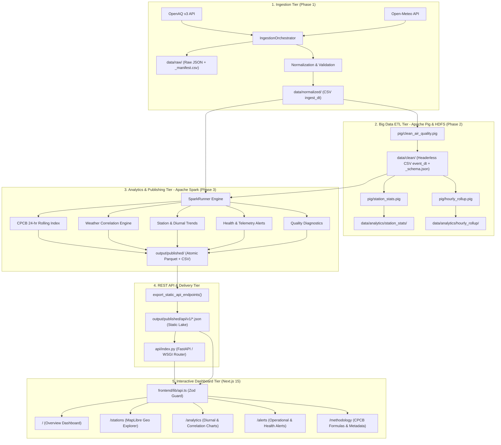

<!-- refreshed: 2026-11-26 -->

# Architecture

**Analysis Date:** 2026-11-26

## System Overview

SkyWatch is an end-to-end Big Data analytics and environmental intelligence platform for Bengaluru air quality and meteorology. The system spans ingestion, distributed batch ETL, analytics, REST endpoint publishing, and an interactive Next.js dashboard.

## Component Responsibilities

1. **Collector & Discovery (`src/skywatch/collector/`):**
   - `openaq_client.py`: Synchronous HTTP client for OpenAQ API v3 with backoff, jitter, and offline test mocks.
   - `weather_client.py`: Fetches hourly meteorological data (temperature, humidity, wind, precipitation) from Open-Meteo.
   - `discovery.py`: Discovers active CAAQMS monitoring stations within Bengaluru's bounding box `[77.45, 12.83, 77.75, 13.12]`.
   - `collector.py`: Coordinates incremental collection, latest snapshots, and chunked historical backfills.

2. **Data Contracts & Validation (`src/skywatch/data/`):**
   - `schemas.py`: Schema validation, contract mapping, sidecar schema generation, and Spark StructType translation against `config/schemas.yaml`.
   - `validation.py`: Record-level validation verifying required fields, numerical ranges, plausible ceilings, unit consistency, and ISO-8601 UTC timestamps.
   - `normalization.py`: Transforms raw OpenAQ v3 objects and Open-Meteo arrays into flat canonical dictionaries.
   - `deduplication.py`: Deterministic composite key generation (`station_id + measurement_time_utc + parameter`) and batch deduplication.

3. **Storage Tier (`src/skywatch/storage/`):**
   - `raw_manifest.py`: Atomic write of raw payload responses and incremental append to `_manifest.csv` audit trails.
   - `storage.py`: Atomic file writing and CSV partition management under `data/normalized/`.
   - `watermark.py`: High-water mark state machine (`data/.watermarks.json`) ensuring idempotent ingestion.
   - `hdfs_storage.py`: HDFS subprocess management with seamless local filesystem fallback (`data/local_hdfs/`).

4. **Big Data ETL Tier - Apache Pig (`pig/` and `src/skywatch/pipeline/`):**
   - `pig/clean_air_quality.pig`: Filters invalid rows, removes duplicates, and partitions data by `event_dt`.
   - `pig/station_stats.pig`: Aggregates min, max, avg, and count per station, parameter, and date.
   - `pig/hourly_rollup.pig`: Computes hourly average concentrations per station and parameter.
   - `src/skywatch/pipeline/pig_runner.py`: Wrapper executing Pig jobs locally or on YARN, with a transparent standalone Python fallback when Apache Pig is absent on the host.

5. **Analytics & Machine Learning Tier - Apache Spark (`src/skywatch/spark/`):**
   - `index_job.py`: Calculates 24-hour rolling CPCB AQI sub-indices using mathematical breakpoint interpolation, enforces >=16 valid hours rules, and assigns suppression reason codes.
   - `weather_analysis.py`: Performs temporal equijoins between clean air quality and weather observations, calculating Pearson $r$ correlation coefficients with sample sizes.
   - `alert_engine.py`: Scans data for CPCB health threshold exceedances, telemetry dropouts, and rolling median concentration spikes.
   - `quality_audit.py`: Tracks record lifecycle metrics across ingestion, cleaning, and analytics stages.
   - `export.py`: Handles atomic staging swaps for dual Parquet/CSV publishing and exports static JSON API endpoints (`output/published/api/v1/*.json`) enriched with measurement freshness and IST time ranges.
   - `src/skywatch/pipeline/spark_runner.py`: Orchestrates the complete analytical execution pipeline with standalone simulation fallback.

6. **REST API & Delivery Tier (`api/`):**
   - `api/index.py`: Serverless REST endpoint supporting FastAPI and WSGI fallback, exposing all 9 atomic analytical endpoints:
     - `GET /api/v1/meta`: Engine verification, execution profile, and generation timestamps.
     - `GET /api/v1/stations`: Monitoring stations, geospatial coordinates, and freshness telemetry.
     - `GET /api/v1/aqi/cpcb-index`: 24-hour rolling CPCB PM-based sub-indices and ratings.
     - `GET /api/v1/analytics/trends/hourly`: Diurnal 24-hour hourly concentrations with UTC and IST mapping.
     - `GET /api/v1/analytics/trends/daily`: Day-of-week relative aggregation and variance profiles.
     - `GET /api/v1/analytics/station-statistics`: Multi-metric station summary statistics and rankings.
     - `GET /api/v1/analytics/weather-correlation`: Meteorology equijoins, Pearson $r$, and confidence tiers.
     - `GET /api/v1/alerts`: Health threshold exceedances, telemetry dropouts, and spikes.
     - `GET /api/v1/audit/quality-report`: Multi-stage pipeline reconciliation and audit diagnostics.

7. **Interactive Dashboard Tier (`frontend/`):**
   - `frontend/components/skywatch.tsx`: Unified dashboard implementation consuming all 9 data loaders with zero placeholder data in production:
     - `Overview`: Dynamically computes citywide mean PM2.5 and PM10 concentrations from active station telemetry rather than hardcoded constants.
     - `Stations`: Projects monitoring stations onto the Bengaluru bounding box using actual coordinates (`[77.45, 12.83, 77.75, 13.12]`) with telemetry freshness indicators.
     - `Analytics`: Displays real station rankings, min/max/average concentrations, dynamic day-of-week relative distribution bars, and real Pearson $r$ correlation coefficients.
     - `Alerts`: Features real health, telemetry, and spike alerts alongside a dedicated Pipeline Data Quality Audit panel reflecting stage records and real dataset CSV downloads.
   - `frontend/lib/api.ts`: Type-safe client orchestrating parallel `Promise.all` fetching across all 9 endpoints with Zod runtime validation and mock fallbacks populated with real published data.
   - `frontend/lib/schemas.ts`: Zod validation schemas supporting integer/string station ID coercion and ISO-8601 UTC timestamp validation.

## Core Architectural Patterns

- **Dual Runtime Profiles:** The system runs identically across `modern` (Hadoop 3.3.6, Pig 0.18.0, Spark 3.5.0) and `lab` (Hadoop 3.2.2, Pig 0.17.0, Spark 3.2.2) without changing application logic or hardcoding runtime versions.
- **Engine Transparency:** Pipeline runners (`pig_runner.py`, `spark_runner.py`) tag every run result and published metadata with the exact executing engine (`APACHE_SPARK`, `APACHE_PIG`, or `STANDALONE_PYTHON_SIMULATION`), allowing the frontend banner to alert users if data was produced by simulation.
- **Atomic Staging Directory Swap:** Output datasets in `output/published/` are written to temporary staging folders, verified, and swapped atomically via filesystem rename, preventing consumers from reading partial writes.
- **Timezone Preservation & Local IST Mapping:** All internal ingestion, storage, and analytics pipelines operate strictly in UTC. Analytical hourly rollups provide explicit IST mapping fields (`hour_of_day_utc`, `ist_time_range`, `ist_label`) to accurately represent Bengaluru diurnal commute patterns without browser-side confusion.
