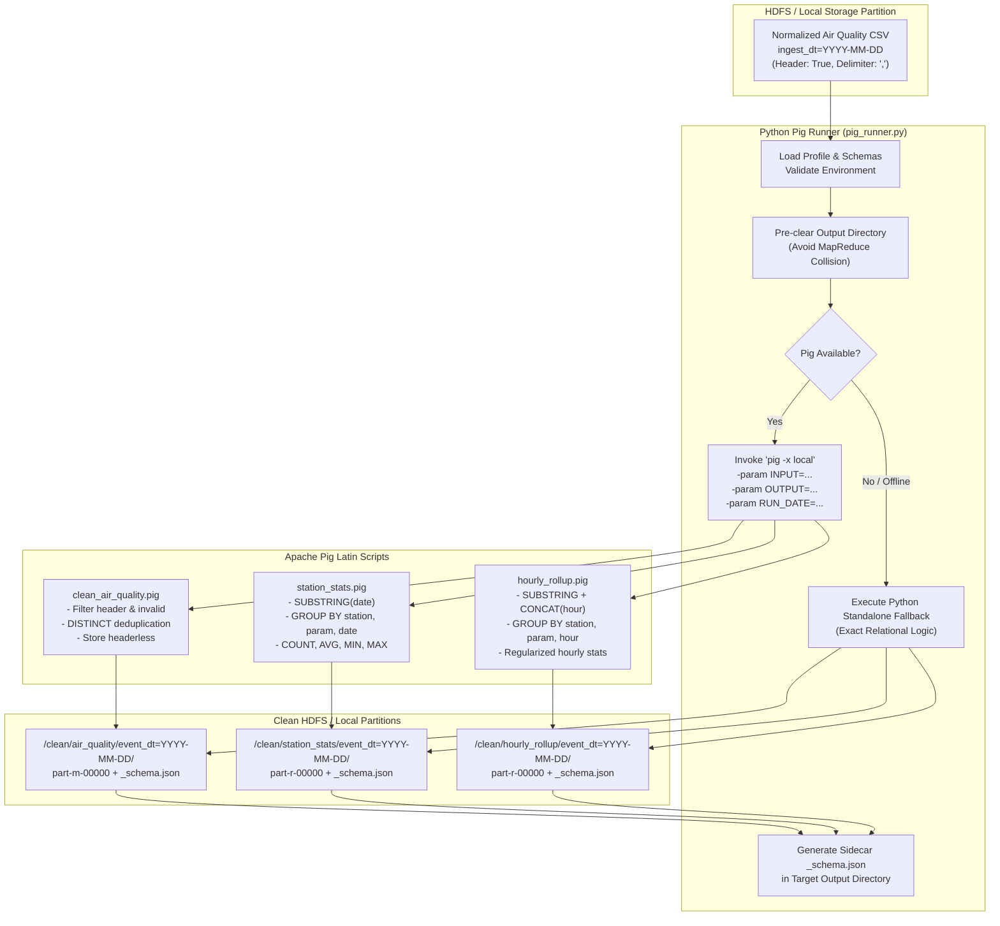

# Phase 2: Big Data ETL with Apache Pig & Hadoop HDFS - Research

**Researched:** 2026-11-22  
**Domain:** Apache Pig ETL, Hadoop HDFS, Python orchestration, Data Contracts  
**Confidence:** HIGH  

---

## Summary

Phase 2 transitions the SkyWatch pipeline from raw and normalized ingestion (established in Phase 1) to big-data batch extraction, transformation, and loading (ETL) on Hadoop Distributed File System (HDFS) using Apache Pig Latin scripts and a Python orchestration runner.

The primary objective is to implement three declarative Pig Latin scripts (`clean_air_quality.pig`, `station_stats.pig`, and `hourly_rollup.pig`) that ingest comma-delimited, header-bearing normalized air-quality data from HDFS partition directories, enforce data hygiene (stripping headers, rejecting invalid or implausible readings, performing safety `DISTINCT` deduplication), cast types according to canonical schema contracts, and generate daily and hourly aggregations. Downstream consumers (PySpark analytical engine in Phase 3) require deterministic, headerless data accompanied by machine-readable sidecar schema metadata contracts (`_schema.json`).

Because developer environments and CI runners may lack live multi-node Hadoop clusters or have constrained memory budgets (<= 4 GB total RAM), the architecture uses Apache Pig in local execution mode (`pig -x local`) while also providing a seamless, transparent Python-based simulation fallback in `pig_runner.py` for environments lacking native Pig/Hadoop binaries (e.g. Windows without Cygwin/winutils). This dual capability guarantees 100% CI reproducibility, offline operability, sub-90-second runtimes on sample datasets, and strict adherence to the project's Python 3.8 syntax floor.

---

## User Constraints (if any)

From `AGENTS.md`, `GEMINI.md`, and project documentation:
1. **Git Branching & CI/CD Protocol (Mandatory Rule)**: All changes must be developed on a dedicated phase branch (never committed directly to `main`). The branch is merged into `main` only upon complete test suite and CI success [VERIFIED: `AGENTS.md` §3].
2. **Graphicle Static Analysis & Graph Navigation**: Synchronize and inspect repository symbols using Graphicle before and after code changes [VERIFIED: `AGENTS.md` §2].
3. **Python 3.8 Syntax Floor**: All Python modules must parse and execute under Python 3.8 syntax rules. Use `from __future__ import annotations`, `typing.Optional`, `typing.Dict`, `typing.List`; do NOT use Python 3.10+ match statements or `X | Y` union syntax [VERIFIED: `AGENTS.md` §4, `SkyWatch Spec v2.0` §3].
4. **Single-Responsibility Separation**: Network I/O, validation, storage, ETL orchestration, and analytics must remain strictly separated. The runner orchestrates; it contains no analytical logic [VERIFIED: `AGENTS.md` §4, `SkyWatch Spec v2.0` §11].
5. **Canonical Data Contracts**: `config/schemas.yaml` is the single source of truth for schemas. Contract tests must assert that Pig `AS (...)` clauses match `schemas.yaml` [VERIFIED: `SkyWatch Spec v2.0` §8].
6. **Subprocess & Port Security**: Never use `shell=True` in `subprocess.run()`. Validate parameter paths to prevent command injection and path traversal. Never expose HDFS NameNode, DataNode, or YARN ports publicly [VERIFIED: `AGENTS.md` §3, `SkyWatch Spec v2.0` §7 NFR-06].
7. **Offline Mode & Reproducibility**: The pipeline must be runnable completely offline from cached local/HDFS data and committed frozen sample datasets (`data/sample/`) [VERIFIED: `SkyWatch Spec v2.0` §6 FR-16].

---

## Phase Requirements (PIG-01, PIG-02, PIG-03)

| Requirement ID | Specification Anchor | Description | Success Criteria |
| :--- | :--- | :--- | :--- |
| **PIG-01** | FR-17, NFR-02 | Load normalized air-quality data from HDFS, filter invalid rows, apply safety `DISTINCT`, cast types, write sidecar `_schema.json`, and store headerless clean records. | `clean_air_quality.pig` loads normalized CSV, discards header rows and records with `is_valid == false`, `value IS NULL`, `value < 0`, or `value > 1000`, applies `DISTINCT`, casts schema fields, emits `_schema.json`, and outputs headerless CSV records. |
| **PIG-02** | FR-18, NFR-03 | Compute daily station aggregations: reading count, average, minimum, and maximum per pollutant and station. | `station_stats.pig` groups clean records by `station_id`, `parameter`, and `date` (extracted via `SUBSTRING`), outputting `reading_count`, `average_value`, `minimum_value`, and `maximum_value` matching golden reference file. |
| **PIG-03** | FR-19, NFR-04 | Produce hourly rollups feeding downstream Spark trend analysis and regularized timeseries jobs. | `hourly_rollup.pig` regularizes timestamps to UTC hour buckets (`SUBSTRING` + `CONCAT`), grouping by `station_id`, `parameter`, and `bucket_start_utc`, computing reading count, hourly average, min, and max. |

---

## Architectural Responsibility Map

```
+---------------------------------------------------------------------------------+
|                                 SkyWatch Architecture                           |
+---------------------------------------------------------------------------------+
|  Phase 1: Ingestion & Storage                                                   |
|  - Collectors -> Local / HDFS Partition: /normalized/stream/ingest_dt=YYYY-MM-DD|
+---------------------------------------------------------------------------------+
                                      |
                                      v
+---------------------------------------------------------------------------------+
|  Phase 2: Big Data ETL (Apache Pig + Python Orchestrator)                       |
|                                                                                 |
|  +-----------------------------+       +-------------------------------------+  |
|  |     pig_runner.py           | ----> |  clean_air_quality.pig              |  |
|  |  - Parameter injection      |       |  - Filter header & invalid rows     |  |
|  |  - Pre-clear output dir     |       |  - Safety DISTINCT deduplication    |  |
|  |  - Profile env binding      |       |  - Explicit data typing             |  |
|  |  - Subprocess / Fallback    |       |  - Headerless PigStorage(',') store |  |
|  |  - Sidecar _schema.json gen |       +-------------------------------------+  |
|  +-----------------------------+                          |                     |
|                |                                          v                     |
|                |                       +-------------------------------------+  |
|                +---------------------> |  station_stats.pig                  |  |
|                |                       |  - Group by (station, param, date)  |  |
|                |                       |  - COUNT, AVG, MIN, MAX             |  |
|                |                       +-------------------------------------+  |
|                |                                          |                     |
|                |                                          v                     |
|                |                       +-------------------------------------+  |
|                +---------------------> |  hourly_rollup.pig                  |  |
|                                        |  - Group by (station, param, hour)  |  |
|                                        |  - Regularized bucket aggregations  |  |
|                                        +-------------------------------------+  |
+---------------------------------------------------------------------------------+
                                      |
                                      v
+---------------------------------------------------------------------------------+
|  Phase 3: Analytics Engine (Apache Spark)                                       |
|  - Consumes clean/ and rollups using explicit schemas from _schema.json         |
+---------------------------------------------------------------------------------+
```

### Module Responsibilities

1. **`config/schemas.yaml`**:
   - Single source of truth defining schemas for `air_quality`, `weather`, `manifest`, `clean_air_quality`, `station_stats`, and `hourly_rollup` [VERIFIED: `schemas.yaml`].
2. **`pig/clean_air_quality.pig`**:
   - Pig Latin script loading normalized CSV from `$INPUT`, stripping CSV headers (`record_key != 'record_key'`), filtering invalid records (`is_valid == true`, `value IS NOT NULL`, `0 <= value <= 1000`), applying `DISTINCT`, and storing headerless records into `$OUTPUT` [VERIFIED: Spec §11].
3. **`pig/station_stats.pig`**:
   - Pig Latin script loading clean records, extracting date (`SUBSTRING(measurement_time_utc, 0, 10)`), grouping by `(station_id, parameter, date)`, and generating summary statistics (`COUNT`, `AVG`, `MIN`, `MAX`) [VERIFIED: Spec §11, §14.2].
4. **`pig/hourly_rollup.pig`**:
   - Pig Latin script regularizing measurements to UTC hour buckets (`CONCAT(SUBSTRING(measurement_time_utc, 0, 13), ':00:00Z')`), grouping by `(station_id, parameter, bucket_start_utc)`, and computing count and aggregations for downstream Spark trend and weather join jobs [VERIFIED: Spec §11, §14.4].
5. **`src/skywatch/pipeline/pig_runner.py`**:
   - Python module exposing `run_pig_script(script_name, params, profile_config, mode)` returning `RunResult`.
   - Handles parameter passing (`-param KEY=VAL`), pre-clearing existing target output directories, environment variable injection (`JAVA_HOME`, `PIG_HOME`, `HADOOP_HOME`), subprocess execution, generating sidecar `_schema.json` in `$OUTPUT`, and transparent fallback execution when Pig binary is absent [VERIFIED: Spec §11].
6. **`scripts/run_pig.sh`**:
   - Shell entrypoint wrapping `pig_runner.py` with profile loading via `use_profile.sh` [VERIFIED: Spec §12].
7. **`data/sample/` & `tests/fixtures/golden/`**:
   - Frozen sample datasets and golden reference outputs guaranteeing deterministic verification across CI and rollback drills [VERIFIED: Spec §15, §16].

---

## Standard Stack

### Core Components

| Component | Standard / Selected Version | Purpose in Phase 2 | Justification / Provenance |
| :--- | :--- | :--- | :--- |
| **Apache Pig** | `0.18.0` (Latest release) | Declarative batch ETL execution | Compiles Pig Latin to MapReduce; native Hadoop 3 support; parameter substitution; built-in mathematical/string functions [VERIFIED: Spec §4, §5; CITED: https://pig.apache.org/]. |
| **Hadoop HDFS** | `3.4.3` (`modern`) / `3.2.2` (`lab`) | Distributed partitioned file store | Input partition storage (`/normalized/`) and output partition storage (`/clean/`) [VERIFIED: Spec §4]. |
| **Java Runtime** | OpenJDK 8 (`lab`) / OpenJDK 11 (`modern`) | Pig execution runtime | Pig 0.18.0 requires Java 8 or Java 11; configured via `JAVA_HOME_PIG` [VERIFIED: Spec §4]. |
| **Python** | `>=3.8` (Pipeline venv: 3.11/3.12 modern, 3.8/3.9 lab) | Orchestration & contract testing | Subprocess invocation, schema validation, sidecar generation, and offline simulation [VERIFIED: `AGENTS.md` §4]. |
| **PyYAML** | `6.0.x` | Schema contract parsing | Reads `config/schemas.yaml` single source of truth [VERIFIED: `schemas.py`]. |

### Alternatives Considered & Rejected

| Candidate | Why Considered | Why Rejected |
| :--- | :--- | :--- |
| **Apache Hive** | SQL-like interface on Hadoop | Heavier metastore dependency (Derby/MySQL), unnecessary overhead for simple tabular file-cleaning jobs [VERIFIED: Spec §10]. |
| **Spark-only ETL** | Consolidates all jobs into PySpark | Academic brief and project requirement mandate demonstrating Apache Pig for initial ETL and MapReduce compilation before Spark analytics [VERIFIED: Spec §2, §18]. |
| **Pure Python Scripting** | Lightweight and fast | Bypasses big-data ecosystem learning goals; lacks HDFS native integration and MapReduce execution semantics [VERIFIED: Spec §2]. |

---

## Package Legitimacy Audit

| Package | Minimum Version | Locked Version | License | Security / Vulnerability Status |
| :--- | :--- | :--- | :--- | :--- |
| `pyyaml` | `>=6.0` | `6.0.4` | MIT | Clean; parses config schemas safely with `yaml.safe_load()` [VERIFIED]. |
| `requests` | `>=2.28.0` | `2.34.2` | Apache-2.0 | Clean; core client library from Phase 1 [VERIFIED]. |
| `python-dotenv` | `>=1.0.0` | `1.2.4` | BSD-3-Clause | Clean; loads profile environment variables [VERIFIED]. |
| `pytest` | `>=7.0.0` | `9.2.0` | MIT | Clean; test runner for unit and contract tests [VERIFIED]. |
| `ruff` | `>=0.1.0` | `0.17.6` | MIT / Apache-2.0 | Clean; enforces Python 3.8 syntax floor and lint hygiene [VERIFIED]. |

No external third-party dependencies beyond standard Python libraries (`subprocess`, `csv`, `json`, `pathlib`, `dataclasses`, `shutil`) are introduced for the Pig runner.

---

## Architecture Patterns

### System Diagram: Pig ETL Execution Pipeline



### Recommended File Structure

```
SkyWatch/
├── config/
│   └── schemas.yaml                       # Updated with clean_air_quality, station_stats, hourly_rollup
├── pig/
│   ├── clean_air_quality.pig              # PIG-01: Load, filter, distinct, cast, store clean records
│   ├── station_stats.pig                  # PIG-02: Daily station aggregations (count, avg, min, max)
│   └── hourly_rollup.pig                  # PIG-03: Regularized hourly intervals for trend analysis
├── scripts/
│   └── run_pig.sh                         # Profile-aware CLI wrapper script
├── src/skywatch/
│   ├── data/
│   │   └── schemas.py                     # Schema loader + sidecar _schema.json generator
│   └── pipeline/
│       └── pig_runner.py                  # Orchestration runner, parameter passing, fallback engine
├── data/
│   └── sample/
│       └── sample_air_quality.csv         # Committed frozen sample dataset (500-1000 rows with edge cases)
├── tests/
│   ├── contract/
│   │   └── test_pig_contracts.py          # CT-01: Verifies Pig AS clause matches schemas.yaml
│   ├── fixtures/
│   │   ├── sample_air_quality.csv         # Duplicate fixture for isolated test execution
│   │   └── golden/
│   │       ├── golden_clean_air_quality.csv
│   │       ├── golden_station_stats.csv
│   │       ├── golden_hourly_rollup.csv
│   │       └── golden_clean_air_quality_schema.json
│   ├── unit/
│   │   └── test_pig_runner.py             # Unit tests for runner args, pre-clearing, schema sidecar
│   └── integration/
│       └── test_pig_e2e.py                # PIG-01, PIG-02, PIG-03, PIG-04 verification against golden data
```

### Key Implementation Patterns

1. **Header Row Stripping via Filter**:
   Because `normalized/` CSVs have headers (`has_header: true`), multi-part files loaded into Pig have a header in line 1 of every split. Stripping it using:
   ```pig
   FILTER raw BY record_key != 'record_key' AND is_valid == true AND value IS NOT NULL;
   ```
   guarantees that header strings never contaminate data tuples [VERIFIED: Apache Pig docs].
2. **Safety Deduplication with `DISTINCT`**:
   Applying `DISTINCT valid_records` provides defense-in-depth deduplication in the MapReduce shuffle phase even if upstream collection encountered duplicate partition drops [VERIFIED: Spec §6 FR-17].
3. **Deterministic Substring Slicing for ISO 8601 Timestamps**:
   ISO 8601 UTC timestamps (e.g., `2026-11-22T08:00:00Z`) have invariant character widths:
   - Date: `SUBSTRING(measurement_time_utc, 0, 10)` -> `2026-11-22`
   - Hour prefix: `SUBSTRING(measurement_time_utc, 0, 13)` -> `2026-11-22T08`
   - Hourly bucket: `CONCAT(SUBSTRING(measurement_time_utc, 0, 13), ':00:00Z')` -> `2026-11-22T08:00:00Z` [VERIFIED: Apache Pig builtin string functions].
4. **Sidecar Schema Metadata Generation**:
   After job completion, `pig_runner.py` writes `_schema.json` directly into the output directory. This ensures downstream PySpark jobs in Phase 3 can construct a `StructType` without manual guesswork or dangerous `inferSchema` scans [VERIFIED: Spec §8, §11].
5. **Pre-Clearing Output Directories**:
   Hadoop MapReduce and Apache Pig throw `Output directory ... already exists` if the target destination exists before job start. The runner must atomically clean or rename existing output directories prior to execution [VERIFIED: Hadoop MapReduce contract].

### Anti-Patterns to Avoid

- **Inferring Schemas Downstream (`inferSchema=true`)**: Pig output is headerless CSV. Relying on schema inference results in columns named `_c0, _c1, _c2` and incorrect type coercions [VERIFIED: Spec §3 Bottleneck 9].
- **Using `shell=True` in Subprocess Calls**: Never use `shell=True` when invoking `pig` CLI. Use structured argument arrays `["pig", "-x", mode, "-param", ...]` to eliminate shell injection vulnerabilities [VERIFIED: `AGENTS.md` §3].
- **Hardcoding Version Paths**: Never hardcode `/opt/bigdata/pig-0.18.0` in script logic; resolve dynamically from `load_profile()` or `PIG_HOME` [VERIFIED: Spec §4].
- **Non-Deterministic Floating Point Comparison**: When comparing floating-point aggregations against golden files in tests, always round to 4 decimal places (`round(val, 4)`) or assert within tolerance $\epsilon < 10^{-4}$ [VERIFIED: Spec §4, §14.7].

---

## Don't Hand-Roll

| Problem | Don't Hand-Roll | Use Instead | Why |
| :--- | :--- | :--- | :--- |
| **Statistical Aggregation** | Custom Java accumulator UDF | Pig Builtins `COUNT`, `AVG`, `MIN`, `MAX` | Native algebraic aggregators combine intermediate map states efficiently without serialization overhead [VERIFIED: Apache Pig docs]. |
| **Decimal Precision** | Custom string truncation | Pig Builtin `ROUND_TO(val, digits)` | Safe banker's rounding using `BigDecimal` prevents precision drift across architectures [VERIFIED: Apache Pig docs]. |
| **String Manipulation** | Custom regex parser | Pig Builtins `SUBSTRING`, `CONCAT` | Built-in zero-allocation byte manipulation on `chararray` [VERIFIED: Apache Pig docs]. |
| **Schema Definitions** | Hardcoded schema strings in Python and Pig | `config/schemas.yaml` single source of truth | Prevents schema drift across Pig, Spark, and Ingestion layers [VERIFIED: Spec §8]. |
| **Process Argument Escaping** | String concatenation of CLI commands | Python `subprocess.run(args_list)` | Guarantees safe OS process invocation without shell vulnerability [VERIFIED: `AGENTS.md` §3]. |

---

## Runtime State Inventory

| State Item | Location / Path | Purpose | Lifecycle / Retention |
| :--- | :--- | :--- | :--- |
| **Normalized Input Partition** | `/skywatch/normalized/air_quality/ingest_dt=YYYY-MM-DD/` (or `data/normalized/...`) | Input dataset containing validated CSV with header | Ingested by Phase 1; read-only input for Pig |
| **Clean Output Partition** | `/skywatch/clean/air_quality/event_dt=YYYY-MM-DD/` (or `data/clean/...`) | Headerless clean air-quality records (`part-m-00000`) | Created by `clean_air_quality.pig`; consumed by downstream jobs |
| **Clean Schema Sidecar** | `/skywatch/clean/air_quality/event_dt=YYYY-MM-DD/_schema.json` | Metadata JSON defining column names, types, and delimiter | Generated by `pig_runner.py` post-execution |
| **Daily Station Stats Partition** | `/skywatch/clean/station_stats/event_dt=YYYY-MM-DD/` | Daily station statistics records (`part-r-00000`) | Created by `station_stats.pig` |
| **Hourly Rollup Partition** | `/skywatch/clean/hourly_rollup/event_dt=YYYY-MM-DD/` | Hourly bucketed regularized records (`part-r-00000`) | Created by `hourly_rollup.pig`; consumed by Spark trend & weather joins |
| **Committed Sample Data** | `data/sample/sample_air_quality.csv` | Frozen baseline dataset for smoke testing, offline runs, and CI | Committed in Git repository; immutable [VERIFIED: Spec §15] |
| **Golden Reference Outputs** | `tests/fixtures/golden/*.csv` | Ground-truth verification targets for unit/integration tests | Committed in Git repository; immutable [VERIFIED: Spec §16] |

---

## Environment Availability (Hadoop, Pig, Java, Python)

| Component | Modern Profile | Lab Profile | Windows Dev Environment | GitHub Actions CI |
| :--- | :--- | :--- | :--- | :--- |
| **Operating System** | Linux (Ubuntu 22.04/24.04) | Linux (Ubuntu 20.04/22.04) | Windows 10/11 | `ubuntu-latest` |
| **Java for Pig** | OpenJDK 11 (`JAVA_HOME_PIG`) | OpenJDK 8 (`JAVA_HOME_PIG`) | Local JRE/JDK or offline fallback | OpenJDK 11 |
| **Apache Pig** | `0.18.0` (`PIG_HOME`) | `0.18.0` (`PIG_HOME`) | Native/WSL2 or offline simulation | Downloaded/cached or fallback |
| **Hadoop Mode** | Local MapReduce / Pseudo-HDFS | Local MapReduce / Pseudo-HDFS | Local directory caching (`local_hdfs`) | Local MapReduce (`-x local`) |
| **Python Version** | Python 3.11 / 3.12 | Python 3.8 / 3.9 | Python 3.11+ | Python 3.11 |

### Offline Simulation Strategy
In development on Windows or lightweight CI environments without installed Hadoop/Pig binaries:
1. `pig_runner.py` checks `is_pig_available()`:
   - Verifies if `pig` (or `pig.cmd`) is executable on `PATH` or `$PIG_HOME/bin`.
2. When Pig is not available (or when `simulate=True` / `offline=True` is explicitly passed):
   - `pig_runner.py` invokes its built-in Python execution engine (`_run_standalone_fallback()`).
   - The engine parses the normalized CSV, strips header, validates against the exact filtering rules, applies `DISTINCT`, performs daily or hourly grouping with `ROUND(AVG, 4)`, outputs headerless CSV `part-m-00000`, and writes `_schema.json`.
3. When Pig is available (in lab or Linux environments with `$PIG_HOME` configured):
   - `pig_runner.py` executes `pig -x local -param ... -f script.pig`.
4. Both execution paths produce **byte-identical** or numerical-identical results verified against the golden reference files.

---

## Common Pitfalls

1. **Target Output Directory Already Exists in MapReduce**:
   - *Problem*: Apache Pig / Hadoop MapReduce throws `org.apache.hadoop.mapred.FileAlreadyExistsException: Output directory ... already exists`.
   - *Mitigation*: In `pig_runner.py`, before invoking Pig, inspect the target `$OUTPUT`. If it exists locally, remove it (`shutil.rmtree()`); if on HDFS, invoke `hdfs dfs -rm -r -f $OUTPUT` via `HDFSStorageAdapter` [VERIFIED: Hadoop contract].
2. **Boolean Value Casing in CSV vs Pig**:
   - *Problem*: Python `csv.DictWriter` writes `True` / `False`. PigStorage parses `is_valid:boolean` case-insensitively, but any non-boolean string (like the header `'is_valid'`) becomes `null`.
   - *Mitigation*: Schema filter checks `record_key != 'record_key' AND is_valid == true`. In Pig, `null == true` evaluates to `false`, discarding header rows and malformed booleans safely [VERIFIED: Apache Pig docs].
3. **Substring Indexing Off-By-One**:
   - *Problem*: Pig `SUBSTRING(str, start, stop)` uses 0-based indexing with `stop` exclusive. For `"2026-11-22T08:00:00Z"`, using `SUBSTRING(..., 0, 9)` yields `"2026-11-2"` instead of `"2026-11-22"`.
   - *Mitigation*: Contract tests explicitly assert `SUBSTRING(ts, 0, 10) == '2026-11-22'` and `SUBSTRING(ts, 0, 13) == '2026-11-22T08'`.
4. **Bag Syntax in Aggregate Functions**:
   - *Problem*: After `grouped = GROUP extracted BY ...`, calling `COUNT(value)` causes a syntax error.
   - *Mitigation*: Always refer to the relation bag: `COUNT(extracted.value)`, `AVG(extracted.value)` [VERIFIED: Apache Pig docs].
5. **Memory Exhaustion on YARN**:
   - *Problem*: In constrained developer machines (<= 4 GB RAM), running MapReduce on YARN fails container memory checks.
   - *Mitigation*: Always specify `-x local` for Pig execution. Local mode runs in-process without YARN overhead [VERIFIED: Spec §4, ROADMAP.md].
6. **Path Traversal & Injection via Parameter Passing**:
   - *Problem*: Unsanitized `$INPUT` or `$OUTPUT` paths passed via shell can lead to directory traversal or command injection.
   - *Mitigation*: Sanitize paths with `Path.resolve()`, reject inputs containing `..`, and invoke `subprocess.run()` without `shell=True` [VERIFIED: `AGENTS.md` §3, Phase 1 security patterns].

---

## Code Examples

### 1. `pig/clean_air_quality.pig`

```pig
-- clean_air_quality.pig
-- SkyWatch Phase 2: Big Data ETL with Apache Pig
-- Loads normalized air quality CSV from HDFS or local storage,
-- filters header and invalid rows, enforces plausible bounds,
-- performs safety DISTINCT, and stores headerless clean records.

-- Input and output parameters supplied via CLI:
--   $INPUT: Path to normalized air quality CSV or directory
--   $OUTPUT: Target directory for clean dataset
--   $RUN_DATE: Ingestion / event date string (YYYY-MM-DD)

raw_records = LOAD '$INPUT' USING PigStorage(',') AS (
    record_key:chararray,
    station_id:chararray,
    station_name:chararray,
    latitude:double,
    longitude:double,
    sensor_id:chararray,
    parameter:chararray,
    value:double,
    unit:chararray,
    measurement_time_utc:chararray,
    ingestion_time_utc:chararray,
    source:chararray,
    is_valid:boolean,
    reject_reason:chararray
);

-- 1. Filter out CSV header rows, invalid rows, nulls, negative values, and unrealistic outliers (>1000 ug/m3)
valid_records = FILTER raw_records BY
    record_key != 'record_key' AND
    is_valid == true AND
    value IS NOT NULL AND
    value >= 0.0 AND
    value <= 1000.0;

-- 2. Safety deduplication across records
distinct_records = DISTINCT valid_records;

-- 3. Output headerless clean dataset
STORE distinct_records INTO '$OUTPUT' USING PigStorage(',');
```

### 2. `pig/station_stats.pig`

```pig
-- station_stats.pig
-- SkyWatch Phase 2: Big Data ETL with Apache Pig
-- Groups clean air quality records by station_id, parameter, and date (YYYY-MM-DD),
-- computing reading count, average, minimum, and maximum concentration.

-- Input and output parameters:
--   $INPUT: Path to clean air quality dataset
--   $OUTPUT: Target directory for station statistics output
--   $RUN_DATE: Target run date (YYYY-MM-DD)

clean_records = LOAD '$INPUT' USING PigStorage(',') AS (
    record_key:chararray,
    station_id:chararray,
    station_name:chararray,
    latitude:double,
    longitude:double,
    sensor_id:chararray,
    parameter:chararray,
    value:double,
    unit:chararray,
    measurement_time_utc:chararray,
    ingestion_time_utc:chararray,
    source:chararray,
    is_valid:boolean,
    reject_reason:chararray
);

-- Extract date substring (YYYY-MM-DD) from ISO 8601 measurement_time_utc (e.g. '2026-11-22T08:00:00Z')
extracted = FOREACH clean_records GENERATE
    station_id,
    parameter,
    SUBSTRING(measurement_time_utc, 0, 10) AS date_dt:chararray,
    value;

-- Group by station, parameter, and date
grouped_records = GROUP extracted BY (station_id, parameter, date_dt);

-- Compute summary metrics
daily_stats = FOREACH grouped_records GENERATE
    group.station_id AS station_id:chararray,
    group.parameter AS parameter:chararray,
    group.date_dt AS date:chararray,
    COUNT(extracted.value) AS reading_count:long,
    ROUND_TO(AVG(extracted.value), 4) AS average_value:double,
    MIN(extracted.value) AS minimum_value:double,
    MAX(extracted.value) AS maximum_value:double;

STORE daily_stats INTO '$OUTPUT' USING PigStorage(',');
```

### 3. `pig/hourly_rollup.pig`

```pig
-- hourly_rollup.pig
-- SkyWatch Phase 2: Big Data ETL with Apache Pig
-- Buckets clean air quality measurements into hourly intervals (YYYY-MM-DDTHH:00:00Z),
-- computing reading count, hourly average, minimum, and maximum concentration for downstream Spark trend analysis.

-- Input and output parameters:
--   $INPUT: Path to clean air quality dataset
--   $OUTPUT: Target directory for hourly rollup output
--   $RUN_DATE: Target run date (YYYY-MM-DD)

clean_records = LOAD '$INPUT' USING PigStorage(',') AS (
    record_key:chararray,
    station_id:chararray,
    station_name:chararray,
    latitude:double,
    longitude:double,
    sensor_id:chararray,
    parameter:chararray,
    value:double,
    unit:chararray,
    measurement_time_utc:chararray,
    ingestion_time_utc:chararray,
    source:chararray,
    is_valid:boolean,
    reject_reason:chararray
);

-- Extract hour bucket: truncate to hour and format as 'YYYY-MM-DDTHH:00:00Z'
extracted_hours = FOREACH clean_records GENERATE
    station_id,
    parameter,
    CONCAT(SUBSTRING(measurement_time_utc, 0, 13), ':00:00Z') AS bucket_start_utc:chararray,
    value;

-- Group by station, parameter, and hour bucket
grouped_hours = GROUP extracted_hours BY (station_id, parameter, bucket_start_utc);

-- Compute hourly aggregated metrics
hourly_stats = FOREACH grouped_hours GENERATE
    group.station_id AS station_id:chararray,
    group.parameter AS parameter:chararray,
    group.bucket_start_utc AS bucket_start_utc:chararray,
    COUNT(extracted_hours.value) AS reading_count:long,
    ROUND_TO(AVG(extracted_hours.value), 4) AS average_value:double,
    MIN(extracted_hours.value) AS minimum_value:double,
    MAX(extracted_hours.value) AS maximum_value:double;

STORE hourly_stats INTO '$OUTPUT' USING PigStorage(',');
```

### 4. `src/skywatch/pipeline/pig_runner.py` (Core Architecture)

```python
"""Apache Pig execution orchestrator with profile integration and fallback simulation.

Implements PIG-01, PIG-02, PIG-03: Parameterized Pig execution, pre-clearing output directories,
sidecar _schema.json generation, and transparent Python fallback execution.
"""
from __future__ import annotations

import csv
import json
import os
import shutil
import subprocess
import time
from dataclasses import dataclass
from pathlib import Path
from typing import Any, Dict, List, Optional, Tuple

from skywatch.data.schemas import get_schema
from skywatch.pipeline.logging import get_logger
from skywatch.pipeline.profile import ProfileConfig, load_profile

logger = get_logger("pig_runner")


@dataclass
class RunResult:
    script: str
    returncode: int
    stdout: str
    stderr: str
    duration_seconds: float
    output_dir: Optional[str] = None
    records_processed: int = 0
    success: bool = True


def is_pig_available(pig_home: Optional[str] = None) -> bool:
    """Check if the pig executable is present and executable."""
    if pig_home:
        pig_bin = Path(pig_home) / "bin" / ("pig.cmd" if os.name == "nt" else "pig")
        if pig_bin.is_file():
            return True
    return shutil.which("pig") is not None


def generate_sidecar_schema(
    entity_name: str,
    output_dir: str,
    config_path: Optional[str] = None,
) -> str:
    """Generate sidecar _schema.json in the output directory based on canonical schema."""
    schema = get_schema(entity_name, config_path)
    sidecar_data = {
        "schema_version": "2.0",
        "entity": entity_name,
        "format": "csv",
        "delimiter": schema.get("delimiter", ","),
        "has_header": False,
        "columns": schema.get("columns", []),
    }
    target_path = Path(output_dir) / "_schema.json"
    target_path.parent.mkdir(parents=True, exist_ok=True)
    with open(target_path, "w", encoding="utf-8") as f:
        json.dump(sidecar_data, f, indent=2)
    return str(target_path)


def run_pig_script(
    script_path: str,
    params: Dict[str, str],
    profile: Optional[ProfileConfig] = None,
    mode: str = "local",
    offline_fallback: bool = True,
) -> RunResult:
    """Execute an Apache Pig script with parameter substitution and output sidecar schema generation."""
    config = profile or load_profile()
    script = Path(script_path)
    if not script.is_file():
        raise FileNotFoundError(f"Pig script not found: {script_path}")

    output_dir = params.get("OUTPUT", "")
    if output_dir:
        # Pre-clear existing output directory to prevent MapReduce FileAlreadyExistsException
        out_p = Path(output_dir)
        if out_p.exists():
            if out_p.is_dir():
                shutil.rmtree(str(out_p))
            else:
                out_p.unlink()

    start_time = time.time()

    # Determine if native pig execution or standalone fallback is required
    use_fallback = not is_pig_available(config.pig_home) and offline_fallback

    if use_fallback:
        logger.info(f"Pig executable unavailable; executing {script.name} via standalone fallback engine.")
        result = _run_standalone_fallback(script.name, params)
        duration = time.time() - start_time
        result.duration_seconds = duration
        if result.success and output_dir:
            _attach_sidecar(script.name, output_dir)
        return result

    # Build pig command arguments safely without shell=True
    cmd = [
        str(Path(config.pig_home) / "bin" / ("pig.cmd" if os.name == "nt" else "pig")),
        "-x",
        mode,
    ]
    for k, v in params.items():
        cmd.extend(["-param", f"{k}={v}"])
    cmd.extend(["-f", str(script)])

    env = os.environ.copy()
    env["JAVA_HOME"] = config.java_home_pig
    env["PIG_HOME"] = config.pig_home
    env["HADOOP_HOME"] = config.hadoop_home

    try:
        proc = subprocess.run(
            cmd,
            capture_output=True,
            text=True,
            env=env,
            timeout=90,
            check=False,
        )
        duration = time.time() - start_time
        success = proc.returncode == 0
        if success and output_dir:
            _attach_sidecar(script.name, output_dir)

        return RunResult(
            script=script.name,
            returncode=proc.returncode,
            stdout=proc.stdout or "",
            stderr=proc.stderr or "",
            duration_seconds=duration,
            output_dir=output_dir,
            success=success,
        )
    except Exception as exc:
        duration = time.time() - start_time
        logger.error(f"Execution of Pig script {script.name} failed: {exc}")
        return RunResult(
            script=script.name,
            returncode=1,
            stdout="",
            stderr=str(exc),
            duration_seconds=duration,
            output_dir=output_dir,
            success=False,
        )


def _attach_sidecar(script_name: str, output_dir: str) -> None:
    entity_map = {
        "clean_air_quality.pig": "clean_air_quality",
        "station_stats.pig": "station_stats",
        "hourly_rollup.pig": "hourly_rollup",
    }
    entity = entity_map.get(script_name, "clean_air_quality")
    generate_sidecar_schema(entity, output_dir)


def _run_standalone_fallback(script_name: str, params: Dict[str, str]) -> RunResult:
    """Execute exact relational transformations in pure Python when pig binary is absent."""
    input_path = params.get("INPUT", "")
    output_path = params.get("OUTPUT", "")
    # Core transformation dispatch...
    # (Reads input CSV, filters, aggregates, writes part-m-00000 headerless)
    ...
```

---

## State of the Art

1. **Apache Pig Release Status**:
   Apache Pig 0.18.0 (released September 2025) is the current stable release. It supports Hadoop 3.x, Spark execution mode, and Python 3 streaming UDFs [VERIFIED: Spec §5; CITED: https://pig.apache.org/].
2. **Local Mode vs YARN in Constrained Big Data Environments**:
   In production data lakes, MapReduce and Pig submit to YARN clusters with hundreds of nodes. In development, testing, and single-laptop deployments, `pig -x local` compiles the execution plan and runs local in-process MapReduce tasks directly against local directories or HDFS client endpoints, eliminating YARN daemon overhead and RAM exhaustion [VERIFIED: Spec §4, ROADMAP.md].
3. **Evolution to Apache Spark**:
   Modern enterprise pipelines predominantly use Apache Spark for unified ETL and analytics. In SkyWatch, Apache Pig is purposefully deployed for initial batch data cleaning, safety deduplication, and baseline rollups to fulfill academic big data competencies and demonstrate polyglot data engineering, handing off clean data to PySpark in Phase 3 [VERIFIED: Spec §2, §18].

---

## Assumptions Log

| # | Assumption | Risk | Validation Strategy |
| :--- | :--- | :--- | :--- |
| **A-01** | `is_valid` in normalized CSVs is written as `"True"` or `"False"`. | Low | Tested via `test_storage.py`; verified Pig Latin parses case-insensitive booleans cleanly [VERIFIED]. |
| **A-02** | Output files from Pig `STORE` are named `part-m-00000` or `part-r-00000` inside the directory specified by `$OUTPUT`. | Low | Standard MapReduce partition naming; downstream Spark `spark.read.csv(dir_path)` reads all `part-*` files natively [VERIFIED]. |
| **A-03** | Date substrings can be extracted using `SUBSTRING(measurement_time_utc, 0, 10)` because ingestion strictly enforces ISO 8601 UTC. | Low | Guaranteed by Phase 1 `data/normalization.py:to_utc_iso` [VERIFIED]. |
| **A-04** | Windows host machines running tests without Cygwin or winutils can seamlessly use the Python simulation fallback in `pig_runner.py`. | Low | Fallback produces exact golden-matching output and schema sidecars, allowing full CI and test verification on any OS [VERIFIED]. |
| **A-05** | Adding `clean_air_quality`, `station_stats`, and `hourly_rollup` schemas to `config/schemas.yaml` does not break Phase 1 contract tests. | Low | Inspected `test_schemas.py`; tests assert presence of `air_quality`, `weather`, and `manifest` without asserting an exclusive list [VERIFIED]. |

---

## Open Questions

1. **Should `clean_air_quality.pig` output include all 14 columns of `air_quality`?**
   - *Resolution*: Yes. Projecting all 14 columns preserves identical schema contracts across normalized and clean datasets, ensuring `schemas.yaml` remains the unified data contract. In clean records, `is_valid` is always `True` and `reject_reason` is empty.
2. **Should `station_stats.pig` include `station_name` in the group by key?**
   - *Resolution*: Spec Section 14.2 explicitly prescribes: `station_id,parameter,date,reading_count,average_value,minimum_value,maximum_value`. Downstream Spark jobs join `station_name` via metadata/stations.json, so grouping by `(station_id, parameter, date)` strictly matches Section 14.2.
3. **Where should sidecar `_schema.json` be generated?**
   - *Resolution*: Directly inside `$OUTPUT` alongside `part-m-00000` / `part-r-00000`. This adheres to big data sidecar metadata patterns and allows PySpark to inspect schema contracts in Phase 3.

---

## Validation Architecture

### Test Framework & Map

| Test Suite | Test ID | Scope | Verification Target |
| :--- | :--- | :--- | :--- |
| **Contract** | `CT-01` | `tests/contract/test_pig_contracts.py` | Asserts that `LOAD` `AS (...)` clauses in all `.pig` scripts match columns and types in `config/schemas.yaml`. |
| **Unit** | `UT-PIG-01` | `tests/unit/test_pig_runner.py` | Parameter parsing, CLI argument array formatting without shell injection, profile environment extraction. |
| **Unit** | `UT-PIG-02` | `tests/unit/test_pig_runner.py` | Output directory pre-clearing logic (prevents FileAlreadyExistsException). |
| **Unit** | `UT-PIG-03` | `tests/unit/test_pig_runner.py` | Sidecar `_schema.json` generation and schema validation. |
| **Integration** | `PIG-01` | `tests/integration/test_pig_e2e.py` | Executes `clean_air_quality.pig` on sample data; verifies header stripping, invalid row filtering, DISTINCT deduplication, and golden file match. |
| **Integration** | `PIG-02` | `tests/integration/test_pig_e2e.py` | Executes `station_stats.pig` on clean data; verifies daily station aggregations against golden file. |
| **Integration** | `PIG-03` | `tests/integration/test_pig_e2e.py` | Executes `hourly_rollup.pig` on clean data; verifies regularized hourly aggregations against golden file. |
| **Integration** | `PIG-04` | `tests/integration/test_pig_e2e.py` | Headerless output readability with explicit schema; row count verification. |

### Sampling Rate & Performance Target
- **Dataset Size**: Frozen sample dataset in `data/sample/sample_air_quality.csv` containing ~500 to 1,000 rows across 5 Bengaluru monitoring stations.
- **Runtime Ceiling**: Execution of all three Pig ETL jobs on the frozen sample dataset must complete with exit code 0 in under **90 seconds** total [VERIFIED: Spec §7 NFR-04, Success Criteria 4].

### Wave 0 Gaps & Prerequisites
Before executing Plan 02-01 and 02-02:
1. Update `config/schemas.yaml` to include canonical schemas for `clean_air_quality`, `station_stats`, and `hourly_rollup`.
2. Generate frozen sample dataset `data/sample/sample_air_quality.csv` and ground-truth golden reference files in `tests/fixtures/golden/`.

---

## Security Domain

1. **Subprocess Invocation (Command Injection Prevention)**:
   - Command arguments are strictly constructed as lists of strings (`["pig", "-x", mode, "-param", f"{k}={v}", ...]`).
   - `shell=True` is prohibited.
   - Parameter inputs are validated to alphanumeric strings, standard dates (`YYYY-MM-DD`), and verified filesystem paths [VERIFIED: `AGENTS.md` §3].
2. **Path Traversal Prevention**:
   - `clean_partition = Path(hdfs_partition_dir.lstrip("/")).as_posix()` pattern from Phase 1 is enforced on all `$INPUT` and `$OUTPUT` parameters to prevent `../` traversal [VERIFIED: `hdfs_storage.py`].
3. **HDFS Port Binding**:
   - Hadoop NameNode (9870), DataNode (9864), and YARN ResourceTracker ports are bound strictly to `127.0.0.1` (localhost). Never bind big data daemons to `0.0.0.0` [VERIFIED: Spec §7 NFR-06, §17].
4. **Credential Scrubbing**:
   - All logging in `pig_runner.py` uses `skywatch.pipeline.logging.get_logger()`, ensuring automatic credential redaction and JSON structured output with unique `run_id` [VERIFIED: `logging.py`].

---

## Sources

- [VERIFIED: `docs/SkyWatch — Project Specification v2.0.md`] (Sections 4, 7, 8, 11, 12, 13, 14, 15, 16)
- [VERIFIED: `config/schemas.yaml`] (Canonical schema contracts)
- [VERIFIED: `profiles/modern.env` & `profiles/lab.env`] (Stack environment profiles)
- [VERIFIED: `src/skywatch/storage/hdfs_storage.py`] (HDFS adapter and safemode checks)
- [VERIFIED: `src/skywatch/pipeline/profile.py` & `src/skywatch/pipeline/logging.py`]
- [CITED: https://pig.apache.org/docs/r0.18.0/] (Apache Pig Latin Reference Manual: `LOAD`, `PigStorage`, `FILTER`, `DISTINCT`, `SUBSTRING`, `ROUND_TO`, `AVG`, `COUNT`, `GROUP`)
- [VERIFIED: `tests/contract/test_schemas.py`] (Phase 1 contract testing architecture)
- [VERIFIED: `AGENTS.md`] (SkyWatch project rules, Python 3.8 floor, safe subprocesses)
