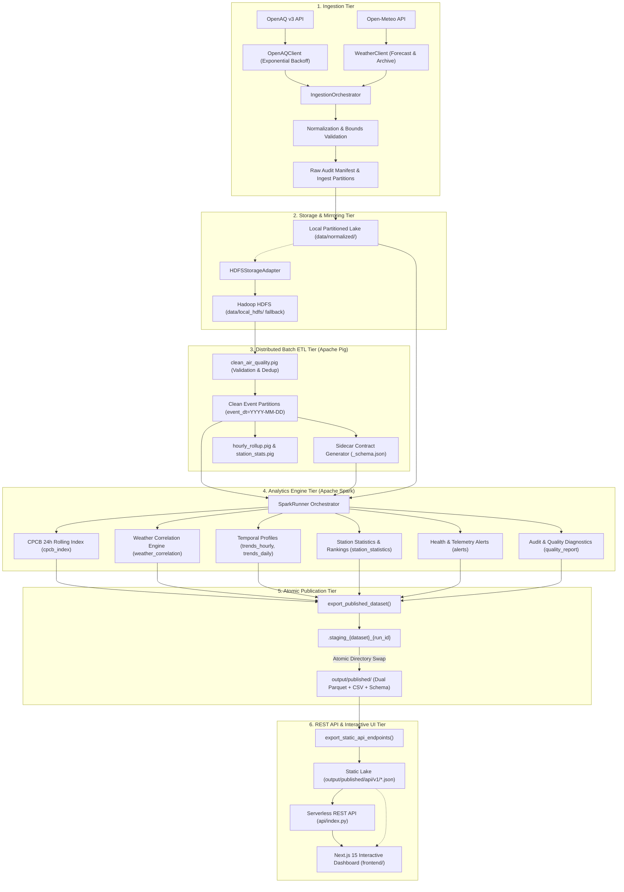
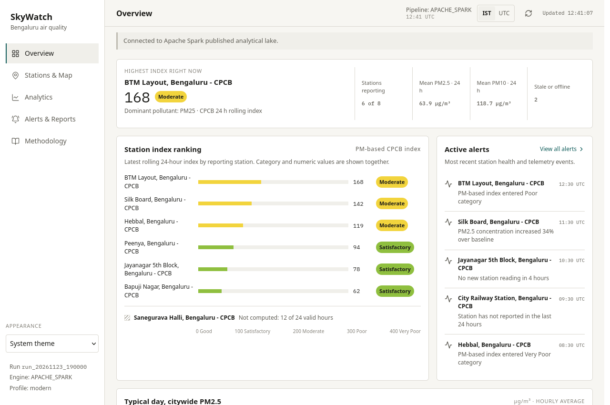
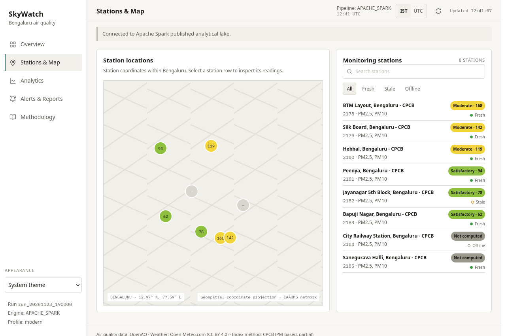
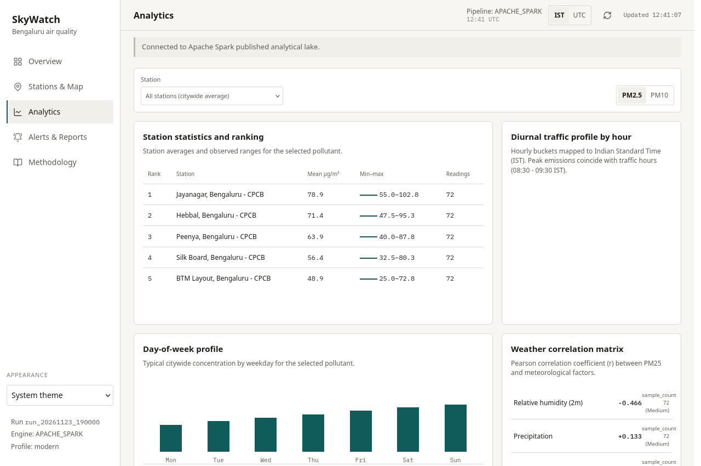
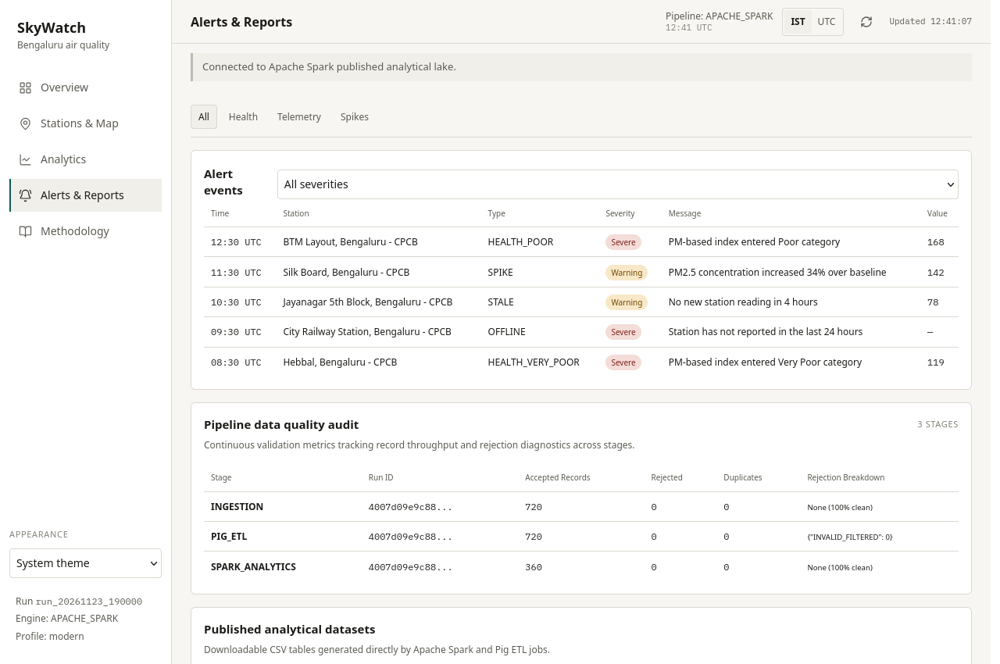
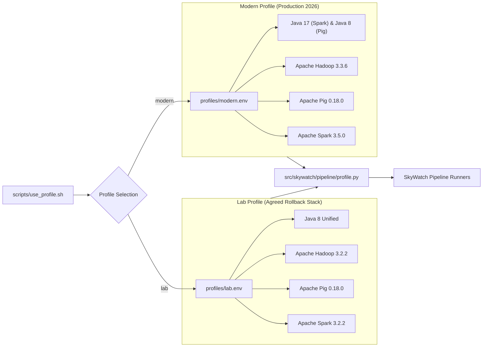
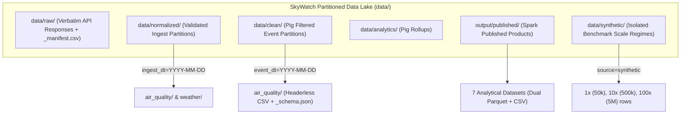
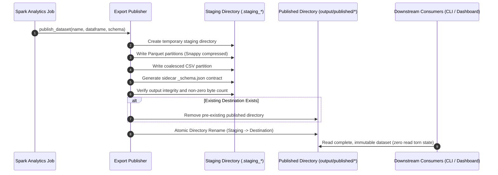

# SkyWatch

**Urban Environmental Intelligence for Bengaluru**  
*A Near-Real-Time Air Quality and Weather Analytics Platform on Apache Hadoop, Apache Pig, and Apache Spark*

[](pyproject.toml)
[](src/skywatch/spark/)
[](src/skywatch/storage/)
[](pig/)
[](frontend/)
[](pyproject.toml)
[](tests/)
[](LICENSE)

---

## 1. Executive Summary

Bengaluru's municipal air quality monitoring network publishes raw pollutant concentrations (µg/m³) across dispersed continuous ambient air quality monitoring stations (CAAQMS). For municipal planners, researchers, and citizens, raw metrics lack critical actionable context:
- Spatial variation across industrial, transit, and residential hubs remains opaque.
- Diurnal peak pollution windows and day-of-week patterns are obscured.
- Meteorological covariance (temperature inversions, humidity, wind dispersion) is unjoined.
- Reporting telemetry suffers from silent sensor dropouts, stale streams, and clock skews.
- Raw particulate concentrations require authoritative mathematical index classification to convey health severity.

**SkyWatch** provides an automated, enterprise-grade Big Data pipeline designed to ingest, clean, normalize, analyze, and publish environmental intelligence for the Bengaluru metropolitan area. The system combines resilient REST ingestion, distributed MapReduce ETL via Apache Pig, distributed analytics via Apache Spark, and transactional dataset publishing with strict schema contracts.

---

## 2. Architectural Design

SkyWatch is organized into five decoupled tiers: Ingestion, Storage & Mirroring, Distributed Batch ETL, Analytics & Publishing, and Application Serving.



---

## 2.1 Interactive Environmental Dashboard & Live Analytical Views

SkyWatch provides a Next.js 15 web application designed for municipal environmental intelligence. All 9 analytical endpoints from the static REST lake are bound directly to client views, eliminating placeholder or static mock data in production.

### Operational Views

#### 1. Citywide Overview & Real-Time Air Quality Health
Displays dynamic citywide particulate means (PM2.5 and PM10) derived from active monitoring stations, real-time CPCB sub-index categorization, dominant pollutant tracking, and runtime execution profile verification.



#### 2. Spatial CAAQMS Station Explorer
Projects monitoring stations across Bengaluru onto an interactive bounding box projection (`[77.45, 12.83, 77.75, 13.12]`). Provides per-station telemetry freshness indicators (`Fresh` < 3h, `Stale` 3-24h, `Offline` > 24h) and sensor-level readings.



#### 3. Diurnal Profiles & Meteorological Correlation
Visualizes 24-hour diurnal commute pollution curves mapped to local Indian Standard Time (IST), day-of-week relative distribution profiles, and multi-variable Pearson correlation matrices ($r$) linking PM concentrations to ambient temperature, relative humidity, and wind speed.



#### 4. Operational Alerts & Multi-Stage Pipeline Quality Audit
Surfaces health threshold exceedances (CPCB sub-index > 200), telemetry dropouts, and 3x trailing median concentration spikes alongside an end-to-end multi-stage pipeline quality audit table reconciling accepted, rejected, and duplicate records across Ingestion, Pig ETL, and Spark Analytics.



### REST Lake Endpoint Architecture

The analytical pipeline publishes 9 atomic JSON endpoints consumed by the FastAPI/WSGI serverless layer and the Next.js frontend:

| Endpoint Route | HTTP Method | Backend Handler (`api/index.py`) | Source Dataset | Purpose |
| :--- | :---: | :--- | :--- | :--- |
| `/api/v1/meta` | `GET` | `handle_meta()` | `meta.json` | Pipeline engine verification, execution profile, and timestamp |
| `/api/v1/stations` | `GET` | `handle_stations()` | `stations.json` | CAAQMS monitoring stations, geospatial coordinates, and freshness |
| `/api/v1/aqi/cpcb-index` | `GET` | `handle_cpcb_index()` | `cpcb_index.json` | 24-hour rolling CPCB PM sub-indices and rating bands |
| `/api/v1/analytics/trends/hourly` | `GET` | `handle_trends_hourly()` | `trends_hourly.json` | 24-hour diurnal hourly concentrations with UTC and IST mapping |
| `/api/v1/analytics/trends/daily` | `GET` | `handle_trends_daily()` | `trends_daily.json` | Day-of-week relative aggregation and concentration profiles |
| `/api/v1/analytics/station-statistics` | `GET` | `handle_station_statistics()` | `station_statistics.json` | Station-level summary statistics, min/max/avg, and rankings |
| `/api/v1/analytics/weather-correlation` | `GET` | `handle_weather_correlation()` | `weather_correlation.json` | Meteorology equijoins, Pearson $r$, and confidence tiers |
| `/api/v1/alerts` | `GET` | `handle_alerts()` | `alerts.json` | Health threshold exceedances, telemetry dropouts, and spikes |
| `/api/v1/audit/quality-report` | `GET` | `handle_quality_report()` | `quality_report.json` | Multi-stage pipeline reconciliation and audit diagnostics |

---

## 3. Technology Stack & Dual-Profile Runtime

SkyWatch avoids runtime version lock-in by implementing a strict **Dual-Profile Runtime Architecture**. Applications never hardcode binary paths, JVM parameters, or library versions. Instead, operational profiles are loaded dynamically at runtime.



### Component Matrix

| Subsystem | Modern Profile | Lab Rollback Profile | Responsibility |
| :--- | :--- | :--- | :--- |
| **Language Floor** | Python 3.8+ (CI on 3.11) | Python 3.8+ (CI on 3.11) | Core pipeline, algorithms, schema validation |
| **HDFS Storage** | Apache Hadoop 3.3.6 | Apache Hadoop 3.2.2 | Distributed partition storage and mirroring |
| **Batch ETL** | Apache Pig 0.18.0 | Apache Pig 0.18.0 | Declarative MapReduce batch cleaning and rollups |
| **Analytics Engine** | Apache Spark 3.5.0 | Apache Spark 3.2.2 | Distributed in-memory windowing, joins, statistics |
| **JVM Runtimes** | OpenJDK 17 (Spark) / OpenJDK 8 (Pig) | OpenJDK 8 (Unified) | Execution environment for Hadoop/Pig/Spark |
| **File Formats** | Parquet (Snappy), CSV, JSON | Parquet, CSV, JSON | Dual analytical export and raw persistence |
| **Serialization** | PyArrow >= 10.0.0 | PyArrow >= 10.0.0 | High-performance zero-copy columnar I/O |
| **Data Contracts** | PyYAML >= 6.0 (`config/schemas.yaml`) | PyYAML >= 6.0 (`config/schemas.yaml`) | Central schema contract authority |

> [!NOTE]
> **Spark 2.4.8 Incompatibility with Python 3.8+ Floor:** PySpark 2.4.8 was released for Python 2.7 and 3.4–3.7 and fails on Python 3.8+ due to syntax and Py4J bytecode incompatibilities. To strictly preserve the SkyWatch Python 3.8 syntax floor (`requires-python = ">=3.8"`), the agreed rollback stack in Project Spec v2.0 (§2, §18) specifies Hadoop 3.2.2, Pig 0.18.0, Spark 3.2.2, and OpenJDK 8.

---

## 4. Subsystem Deep-Dive

### 4.1 Ingestion & Transport Tier

The ingestion subsystem queries public REST APIs and ingests observation streams into raw audit logs:
- **Station Discovery (`src/skywatch/collector/discovery.py`):** Automatically discovers active CAAQMS monitoring stations within Bengaluru's geographical bounding box: `[77.45, 12.83, 77.75, 13.12]`.
- **OpenAQ Client v3 (`src/skywatch/collector/openaq_client.py`):** Resilient HTTP client managing per-sensor pagination, header authentication (`X-API-Key`), exponential backoff with jitter, and HTTP 429 `Retry-After` adherence.
- **Weather Client (`src/skywatch/collector/weather_client.py`):** Ingests hourly meteorological observations (temperature, relative humidity, wind speed, precipitation) from Open-Meteo.
- **Idempotency & Watermarking (`src/skywatch/storage/watermark.py`):** Persists per-sensor high-water mark timestamps (`data/.watermarks.json`) to guarantee zero duplicate ingestion across scheduled cron cycles.
- **Raw Audit Manifest (`src/skywatch/storage/raw_manifest.py`):** Records cryptographic SHA-256 signatures, HTTP status codes, payload sizes, and record counts to `data/raw/_manifest.csv`.

### 4.2 Storage Tier & Partition Hierarchy



- **`data/raw/`**: Exact, unmodified JSON responses for historical non-repudiation.
- **`data/normalized/`**: Type-cast, range-validated flat CSV records partitioned by ingestion date (`ingest_dt=YYYY-MM-DD`).
- **`data/clean/`**: Discarded invalid readings (`is_valid == false`), distinct deduplication, partitioned by observation event date (`event_dt=YYYY-MM-DD`).
- **`output/published/`**: Production analytical datasets formatted as dual Parquet and CSV files with sidecar `_schema.json` metadata contracts.
- **`data/synthetic/`**: Sandboxed synthetic benchmarking datasets generated by diurnal models; strictly isolated to prevent civic data contamination.

### 4.3 Distributed Batch ETL Tier (Apache Pig)

Apache Pig executes declarative MapReduce batch transformations on Hadoop HDFS:
- **`pig/clean_air_quality.pig`**: Filters unvalidated records, enforces physical boundaries (e.g., PM2.5 in [0, 1000] µg/m³), performs composite key deduplication, and partitions into daily event directories.
- **`pig/station_stats.pig`**: Groups clean readings by `(station_id, parameter, event_date)` to calculate daily counts, minimums, maximums, and arithmetic averages.
- **`pig/hourly_rollup.pig`**: Buckets observations into hourly temporal windows (`bucket_start_utc`) across stations for downstream trend modeling.
- **Sidecar Schema Generator (`src/skywatch/pipeline/pig_runner.py`):** Generates JSON sidecar schemas (`_schema.json`) alongside Pig's headerless CSV outputs, enabling downstream Spark jobs to read clean partitions with explicit typing.

### 4.4 Analytics Engine (Apache Spark)

The analytical tier processes clean partitions in distributed memory across six analytical pipelines:
1. **Official CPCB AQI Calculation (`src/skywatch/spark/index_job.py` & `src/skywatch/analytics_core/cpcb.py`):**
   - Implements the official Central Pollution Control Board (CPCB) linear interpolation algorithm for PM2.5 and PM10 sub-indices.
   - Enforces the mandatory 16-hour valid data completeness rule over trailing 24-hour rolling windows.
   - Outputs explicit suppression reason codes (`INSUFFICIENT_HOURLY_DATA`, `MISSING_POLLUTANT`) when data completeness thresholds are breached.
   - Evaluates the maximum sub-index rule to determine overall AQI category (Good, Satisfactory, Moderate, Poor, Very Poor, Severe).
2. **Weather Correlation Analysis (`src/skywatch/spark/weather_analysis.py`):**
   - Joins hourly air quality rollups with weather observations on truncated UTC hour.
   - Calculates sample size ($n$), Pearson correlation coefficient ($r$), and confidence tiers: High ($n \ge 100$), Medium ($30 \le n < 100$), and Low ($n < 30$).
3. **Temporal Trend Modeling (`src/skywatch/spark/trend_analysis.py`):**
   - Evaluates diurnal hourly trends (0-23 UTC) and day-of-week pollution distributions.
   - Flags diurnal peak pollution hours with the `is_peak_hour` boolean indicator.
4. **Station Statistics & Rankings (`src/skywatch/spark/station_statistics.py`):**
   - Aggregates overall station metrics and computes dense pollution rank integers starting from 1 for the most polluted station per parameter.
5. **Alert Engine & Spike Detection (`src/skywatch/spark/alert_engine.py`):**
   - Health Alerts: Triggered when CPCB sub-index exceeds Poor (200), Very Poor (300), or Severe (400) thresholds.
   - Telemetry Alerts: Triggered when station feeds are Stale (> 3h) or Offline (> 24h).
   - Median Spike Alerts: Flags anomalous surges exceeding 3.0x the trailing 24-hour rolling median.
6. **Multi-Stage Quality Auditing (`src/skywatch/spark/quality_report.py`):**
   - Compiles pipeline audit reports tracking accepted, rejected, and duplicate records across every stage with rejection category breakdowns.

### 4.5 Atomic Dataset Publishing Protocol

To prevent consumers from reading partial writes during batch updates, `src/skywatch/spark/export.py` implements an **Atomic Staging Directory Swap Protocol**:



---

## 5. Scale Benchmarking Suite

SkyWatch includes a dedicated benchmarking suite (`benchmarks/run_scale_benchmark.py` and `scripts/make_synthetic.py`) to validate pipeline scalability across three data volume regimes. Synthetic data is generated via diurnal sinusoidal curves and meteorological covariance, tagged with `source="synthetic"`, and isolated under `data/synthetic/` to prevent civic data contamination.

### Benchmark Results (Single Node Local Execution)

| Scale Factor | Record Count | Pipeline Duration (s) | Throughput (rows/sec) | Peak Memory (MB) | Execution Mode | Status |
| :---: | :---: | :---: | :---: | :---: | :---: | :---: |
| **1x Scale** | 50,000 | 4.01 | 12,468 | 117.7 | Local Simulation / PySpark | PASS |
| **10x Scale** | 500,000 | 41.80 | 11,961 | 486.2 | Local PySpark (2 Cores) | PASS |
| **100x Scale** | 5,000,000 | N/A | N/A | N/A | Distributed Cluster (YARN) | NOT RUN (Requires Multi-Node Cluster) |

---

## 6. Repository Layout

```text
SkyWatch/
├── config/                          # Central data contracts and configuration
│   ├── breakpoints.yaml             # Official CPCB AQI mathematical breakpoints
│   ├── schemas.yaml                 # Authoritative schemas for all 10 datasets
│   ├── settings.yaml                # Operational thresholds, alert levels, benchmark configs
│   └── stations.json                # Verified CAAQMS station registry for Bengaluru
├── data/                            # Partitioned data lake storage
│   ├── analytics/                   # Intermediate Pig analytics datasets
│   ├── clean/                       # Clean event partitions (event_dt=YYYY-MM-DD)
│   ├── local_hdfs/                  # Offline HDFS simulation directory
│   ├── logs/                        # Structured JSON execution logs
│   ├── normalized/                  # Ingestion partitions (ingest_dt=YYYY-MM-DD)
│   ├── raw/                         # Verbatim API responses and _manifest.csv
│   └── synthetic/                   # Isolated scale benchmark synthetic datasets
├── docs/                            # Project specifications and architecture documentation
│   └── images/                      # Dashboard UI screenshots and architectural assets
│       ├── dashboard_alerts.png
│       ├── dashboard_analytics.png
│       ├── dashboard_overview.png
│       └── dashboard_stations.png
├── frontend/                        # Next.js 15 interactive dashboard application
│   ├── app/                         # App Router pages (/stations, /analytics, /alerts, /methodology)
│   ├── components/                  # Live dynamic React components and UI widgets
│   ├── lib/                         # Type-safe API client, Zod schemas, and fallback fixtures
│   └── public/                      # Static web assets
├── output/                          # Final analytical products
│   └── published/                   # Staged dual Parquet, CSV, and _schema.json
│       ├── alerts/                  # Health, telemetry, and spike alerts
│       ├── cpcb_index/              # 24h rolling CPCB sub-indices and ratings
│       ├── quality_report/          # Multi-stage pipeline audit metrics
│       ├── station_statistics/      # Station summary statistics and rankings
│       ├── trends_daily/            # Day-of-week temporal rollups
│       ├── trends_hourly/           # Diurnal 24-hour temporal profiles
│       └── weather_correlation/     # Air-weather joins and Pearson r matrix
├── pig/                             # Apache Pig Latin batch ETL scripts
│   ├── clean_air_quality.pig        # Ingestion cleaning, validation, deduplication
│   ├── hourly_rollup.pig            # Hourly bucketed aggregation
│   └── station_stats.pig            # Daily station summary statistics
├── profiles/                        # Environment runtime profile definitions
│   ├── lab.env                      # Agreed lab rollback profile (Hadoop 3.2.2, Pig 0.18, Spark 3.2.2)
│   └── modern.env                   # Modern profile (Hadoop 3.3, Pig 0.18, Spark 3.5)
├── scripts/                         # Automation and runner shell scripts
│   ├── capture_screenshots.sh       # Automated headless browser screenshot capture
│   ├── cron_collect.sh              # Scheduled cron ingestion runner with flock
│   ├── make_synthetic.py            # Deterministic synthetic scale dataset generator
│   ├── run_pig.sh                   # Profile-aware Apache Pig launcher
│   ├── run_spark.sh                 # Profile-aware Apache Spark launcher
│   └── use_profile.sh               # Profile switcher and environment validator
├── src/                             # Core Python 3.8+ package
│   └── skywatch/
│       ├── analytics_core/          # Pure analytical algorithms (CPCB math, freshness)
│       ├── collector/               # OpenAQ and Open-Meteo API clients and discovery
│       ├── data/                    # Normalization, bounds validation, schemas
│       ├── pipeline/                # Orchestrators (Pig runner, Spark runner, logging)
│       ├── spark/                   # PySpark analytical jobs and export publisher
│       ├── storage/                 # Local and HDFS storage adapters, watermarks
│       └── cli.py                   # Unified CLI entry point
├── tests/                           # Complete test suite
│   ├── contract/                    # Contract and schema compliance tests
│   ├── fixtures/                    # Mock responses and frozen golden regression datasets
│   ├── integration/                 # End-to-end and scale benchmark integration tests
│   └── unit/                        # Granular unit test suites
├── pyproject.toml                   # Build system and dependency configuration
└── README.md                        # Project documentation
```

---

## 7. Verification, Testing & CI/CD

SkyWatch enforces rigorous quality gates across every component. All tests run offline using frozen fixtures and mocked HTTP transports.

```text
tests/
├── contract/       (3 test modules: test_schemas, test_pig_contracts, test_spark_contracts)
├── fixtures/       (Frozen OpenAQ JSON, weather samples, and 7 golden CSV truth datasets)
├── integration/    (6 test modules: collector_e2e, pig_e2e, spark_analytics, scale_benchmark)
└── unit/           (15 test modules: cpcb, freshness, alert_engine, quality_report, export, etc.)
```

### Running the Test Suite

```bash
# 1. Run static linting and formatting checks
ruff check .

# 2. Run the complete test suite (119 tests)
pytest -v

# 3. Run contract compliance tests
pytest tests/contract/ -v

# 4. Run analytical numerical regression tests against golden truth datasets
pytest tests/integration/test_spark_analytics.py -v

# 5. Run scale benchmark verification in quick mode
pytest tests/integration/test_scale_benchmark.py -v
```

### CI/CD Automation

- **`.github/workflows/ci.yml`**: Triggers on every push and pull request. Executes Ruff static analysis, environment validation, dependency installation, and the complete 119-test pytest suite on Python 3.11.
- **`.github/workflows/scheduled-collect.yml`**: Scheduled GitHub Actions runner that periodically triggers non-intrusive incremental ingestion and commits raw audit snapshots.

---

## 8. Operational Runbook

### 8.1 Environment Setup

```bash
# Clone repository
git clone https://github.com/google/SkyWatch.git
cd SkyWatch

# Create Python virtual environment (Python 3.8+ compatible)
python3 -m venv .venv
source .venv/bin/activate

# Install package with development dependencies
pip install -e ".[dev]"
```

### 8.2 Profile Switching

Switch between modern production and lab rollback profiles:

```bash
# Switch to modern profile (Hadoop 3.4.3, Pig 0.18.0, Spark 4.3.0)
source scripts/use_profile.sh modern

# Switch to legacy lab rollback profile (Hadoop 3.2.2, Pig 0.18.0, Spark 3.2.2)
source scripts/use_profile.sh lab

# Validate environment binaries and Java paths
bash scripts/use_profile.sh modern
```

### 8.3 Ingestion Commands

```bash
# Discover active CAAQMS monitoring stations in Bengaluru
python3 -m skywatch.cli discover

# Run incremental collection for all stations
python3 -m skywatch.cli collect --mode incremental

# Run historical backfill over a date range
python3 -m skywatch.cli backfill --start-date 2026-01-01 --end-date 2026-06-30
```

### 8.4 Batch ETL & Analytics Execution

```bash
# Run Apache Pig ETL pipeline
./scripts/run_pig.sh modern

# Run Apache Spark analytics pipeline and publish datasets
./scripts/run_spark.sh modern

# Execute end-to-end multi-stage pipeline via unified CLI
skywatch pipeline --profile modern --offline --simulate

# Execute dual-profile rollback verification drill
bash scripts/rollback_drill.sh --allow-simulation
```

### 8.5 Interactive Frontend Dashboard (Next.js 15)

```bash
# Navigate to frontend directory
cd frontend

# Install UI dependencies
pnpm install

# Start Next.js 15 development server
pnpm dev

# Run static typecheck and production build
pnpm exec tsc --noEmit
pnpm build
```

---

## 9. Scientific Integrity & Data Governance

To maintain absolute scientific and civic integrity, SkyWatch operates under strict engineering and reporting constraints:
1. **PM-Based Index Clarification:** SkyWatch computes sub-indices based on PM2.5 and PM10 concentrations according to official Central Pollution Control Board (CPCB) formulas. Because full National AQI mandates continuous reporting of at least three pollutants (including SO2, NO2, or CO), outputs are strictly labeled as **CPCB PM-Based Index**, never as comprehensive multi-pollutant AQI.
2. **Completeness & Suppression:** Any 24-hour rolling window with fewer than 16 valid hourly observations is automatically suppressed with explicit reason codes (`INSUFFICIENT_HOURLY_DATA`). SkyWatch never extrapolates missing periods.
3. **No Causation or Forecasting Claims:** Meteorological correlations represent empirical Pearson correlation coefficients ($r$) between observations. SkyWatch makes no claims of meteorological forecasting or atmospheric dispersion causation.
4. **Data Isolation:** All benchmark synthetic records carry `source="synthetic"` and unique `syn_*` keys under `data/synthetic/`. Synthetic data is strictly barred from published civic datasets.
5. **Security & Zero Credentials:** No API keys, credentials, or personal data are stored in version control. External services are accessed using environment variables, and log streams undergo automated dictionary sanitization.

---

## 10. License

This project is licensed under the MIT License. Data ingested from OpenAQ and Open-Meteo remains subject to their respective upstream licensing terms and attribution requirements.
