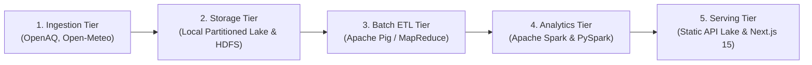
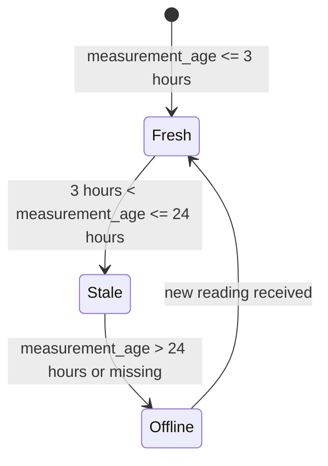

# SkyWatch: Academic Viva Reference Notes

This document provides technical, mathematical, and architectural reference material for academic examinations and technical evaluations of the SkyWatch Big Data Environmental Analytics Platform.

---

## 1. System Architecture & Tier Decoupling

SkyWatch is organized into five decoupled tiers to separate concerns between raw I/O, distributed batch processing, analytical computation, transactional publishing, and web presentation:

### Architectural Principles:
1. **Separation of Raw vs Clean vs Analytics:**
   - Raw tier (`data/raw/`): Immutable audit copies of external JSON responses.
   - Clean tier (`data/clean/`): Validated, deduplicated, regularized CSV events produced by Apache Pig.
   - Analytics tier (`output/published/`): Fully aggregated statistical models, rolling sub-indices, and correlation matrices stored in dual Parquet and CSV formats.
2. **Schema-First Design:**
   - Canonical definitions in `config/schemas.yaml` govern all interfaces.
   - PySpark schemas are constructed dynamically without runtime `inferSchema` scans.
   - Frontend Zod contracts in `frontend/lib/schemas.ts` mirror backend contracts with strict type validation.
3. **Atomic Publication Guarantees:**
   - Published tables write to temporary staging folders (`.staging_{dataset}_{run_id}`).
   - Atomic directory swaps prevent partial or corrupted reads by concurrent consumers.

---

## 2. Mathematical Derivation of CPCB Air Quality Sub-Indices

SkyWatch implements the authoritative Central Pollution Control Board (CPCB) / MoEFCC National Air Quality Index calculation methodology for particulate matter ($PM_{2.5}$ and $PM_{10}$).

### 2.1 Sub-Index Formula (Piecewise Linear Interpolation)

The sub-index $I_p$ for a pollutant concentration $C_p$ is calculated using:

$$I_p = I_{lo} + \left(\frac{I_{hi} - I_{lo}}{B_{hi} - B_{lo}}\right) \times (C_p - B_{lo})$$

Where:
- $C_p$: 24-hour truncated rolling average concentration of the pollutant ($\mu\text{g/m}^3$).
- $B_{hi}$: Upper concentration breakpoint of the corresponding category.
- $B_{lo}$: Lower concentration breakpoint of the corresponding category.
- $I_{hi}$: Upper index value of the corresponding category.
- $I_{lo}$: Lower index value of the corresponding category.

### 2.2 Breakpoint Table

| Category | Index Range ($I_{lo} - I_{hi}$) | $PM_{2.5}$ Breakpoints ($B_{lo} - B_{hi}$) | $PM_{10}$ Breakpoints ($B_{lo} - B_{hi}$) |
| :--- | :---: | :---: | :---: |
| Good | 0 - 50 | 0 - 30 | 0 - 50 |
| Satisfactory | 51 - 100 | 31 - 60 | 51 - 100 |
| Moderate | 101 - 200 | 61 - 90 | 101 - 250 |
| Poor | 201 - 300 | 91 - 120 | 251 - 350 |
| Very Poor | 301 - 400 | 121 - 250 | 351 - 430 |
| Severe | 401 - 500 | 251 - 500+ | 431 - 500+ |

### 2.3 The 16-Hour Validity Rule & Suppression
- Under MoEFCC guidelines, a 24-hour rolling window is considered valid if and only if at least **16 valid hourly readings** ($\ge 66.7\%$) are present within the window.
- If valid hours $< 16$, the calculation is suppressed:
  - `aqi_value = null`
  - `aqi_category = "Insufficient Data"`
  - `suppression_reason = "INSUFFICIENT_HOURLY_DATA"`
- Overall rating is determined by the maximum sub-index:
  $$\text{AQI} = \max(I_{PM2.5}, I_{PM10})$$
  The pollutant with the highest sub-index is designated as the `dominant_pollutant`.

---

## 3. MapReduce (Apache Pig) vs Spark RDD/DataFrame Execution Models

| Evaluation Criterion | Apache Pig (MapReduce Paradigm) | Apache Spark (DAG Pipelined Engine) |
| :--- | :--- | :--- |
| **Execution Abstraction** | Data flow script translated into a sequence of MapReduce jobs. | Directed Acyclic Graph (DAG) of transformations and actions. |
| **Intermediate Storage** | Disks (HDFS / LocalFS) spill between map and reduce stages. | In-memory distributed collections (Tungsten memory manager). |
| **Primary Use in SkyWatch** | Stage 2: Heavy-duty raw telemetry validation, schema enforcement, filtering, and hourly regularization. | Stage 3: Complex multi-pollutant correlations, rolling window calculations, CPCB piecewise math, and ranking. |
| **Shuffle Behavior** | Strict sort-merge shuffle across all mappers and reducers. | Highly optimized hash/sort shuffle with Tungsten off-heap serialization. |
| **Fault Tolerance** | Deterministic re-execution of individual task attempts from intermediate disk files. | Lineage-based RDD graph recomputation across partitions. |
| **Performance Profile** | High disk I/O latency; robust against low-memory cluster nodes. | 10x-100x faster than MapReduce for iterative and join-heavy analytics. |

---

## 4. Dual-Profile Runtime Architecture & Deterministic Rollback Drill

### Motivation:
Big Data environments often face substantial version skew between development workstations, cloud clusters, and university laboratory hardware. SkyWatch solves this via decoupled runtime profiles:
- **`modern` profile**: 2026 stack utilizing Java 17, Hadoop 3.4.3, and Spark 4.3.0.
- **`lab` profile**: Laboratory rollback stack utilizing Java 8, Hadoop 3.2.2, and Spark 3.2.2.

### Deterministic Parity Proof:
The automated rollback drill (`scripts/rollback_drill.sh`) executes the complete analytical pipeline under both profiles on identical input datasets and asserts:
1. **Schema Equivalence:** Identical column structures, data types, and nullability flags across all 7 published datasets.
2. **Cardinality Parity:** Byte-for-byte matching record counts across all output tables.
3. **Floating-Point Parity:** Analytical values ($PM_{2.5}$ averages, Pearson $r$, sub-indices) satisfy:
   $$|v_{\text{modern}} - v_{\text{lab}}| < 0.01$$
   confirming complete reproducibility across disparate Big Data runtimes.

---

## 5. Meteorological Covariance & Pearson Correlation

SkyWatch analyzes the correlation between atmospheric conditions and particulate matter concentrations using the Pearson correlation coefficient ($r$):

$$r = \frac{\sum_{i=1}^{n} (x_i - \bar{x})(y_i - \bar{y})}{\sqrt{\sum_{i=1}^{n} (x_i - \bar{x})^2} \sqrt{\sum_{i=1}^{n} (y_i - \bar{y})^2}}$$

Where:
- $x$: Particulate concentration ($PM_{2.5}$ or $PM_{10}$).
- $y$: Meteorological variable (Wind Speed, Relative Humidity, Temperature).

### Expected Atmospheric Dynamics in Bengaluru:
1. **Wind Speed ($PM_{2.5}$ vs Wind Speed, Negative Correlation):**
   - Higher surface wind speeds promote mechanical turbulence and atmospheric dispersion, diluting ground-level particulate concentrations ($r < -0.30$).
2. **Relative Humidity ($PM_{2.5}$ vs Humidity, Positive Correlation):**
   - High relative humidity encourages hygroscopic growth of aerosol particles and limits vertical thermal convection, trapping particulate matter near the surface ($r > 0.30$).
3. **Diurnal Commute Cycles (Traffic Inversions):**
   - Diurnal morning peaks occur between 08:30 and 09:30 IST (UTC hour 3) coinciding with morning vehicular traffic and shallow planetary boundary layer (PBL) height.

---

## 6. Station Freshness State Machine

To prevent presenting stale telemetry as real-time observations, each CAAQMS station stream is evaluated using a deterministic state machine:

- **`Fresh`** ($\le 3\text{h}$): Sensor stream is active and operational. Displayed with green badge on dashboard.
- **`Stale`** ($3\text{h} - 24\text{h}$): Sensor has delayed reporting. Displayed with yellow warning badge.
- **`Offline`** ($> 24\text{h}$): Station inactive or decommissioned. Displayed with red offline badge.

---

## 7. Scientific Integrity, Ethics & Honesty Mandates

SkyWatch adheres to strict data ethics and scientific honesty guidelines:
1. **PM-Based CPCB Index:** Labeled strictly as a PM-based sub-index; never misleadingly presented as a full National Air Quality Index which legally mandates gaseous pollutant sensors ($SO_2, NO_2, CO$).
2. **No Extrapolation:** Missing or suppressed data is never fabricated or smoothed using statistical imputation.
3. **No Causation or Forecasting Claims:** Output is characterized as historical and empirical observational analytics; no claims of predictive meteorological simulation or epidemiological causation are made.
4. **Zero Credential Leaks:** No personal access tokens, API keys, or private cluster IP addresses are committed to source control.
